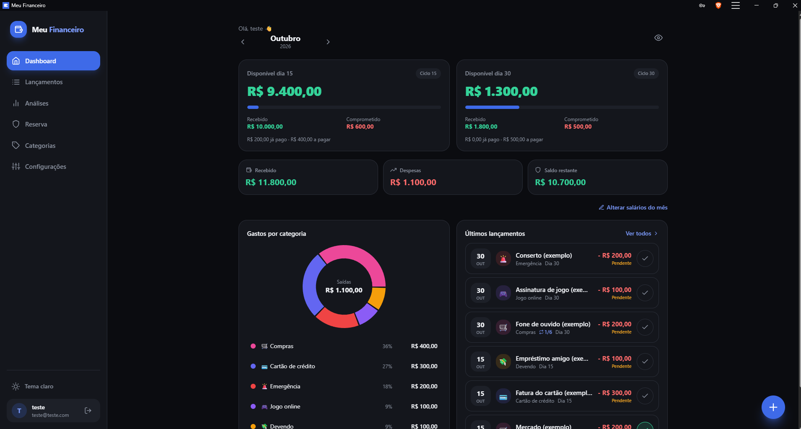
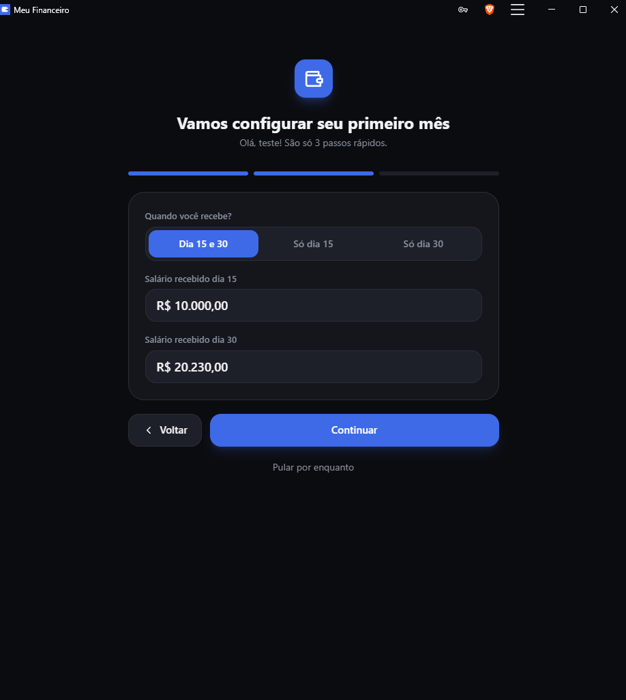
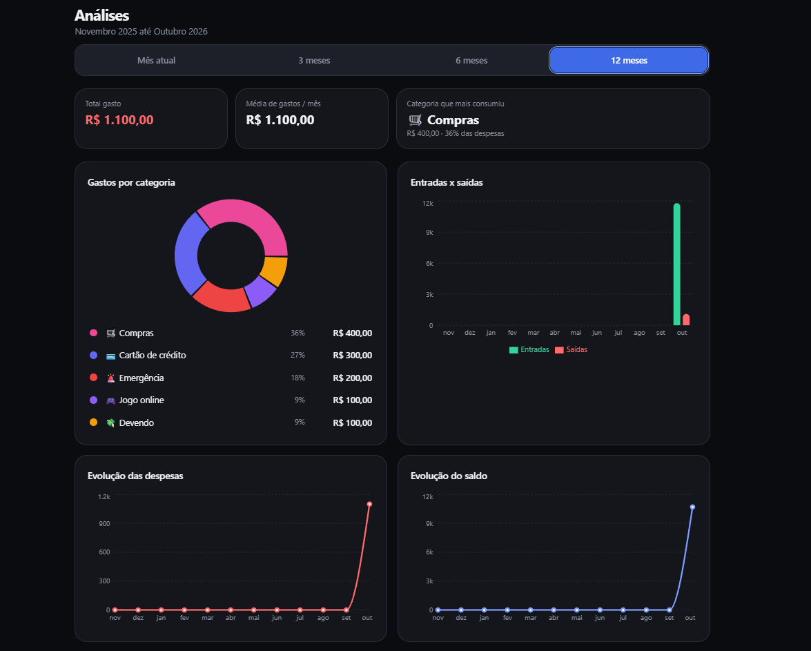
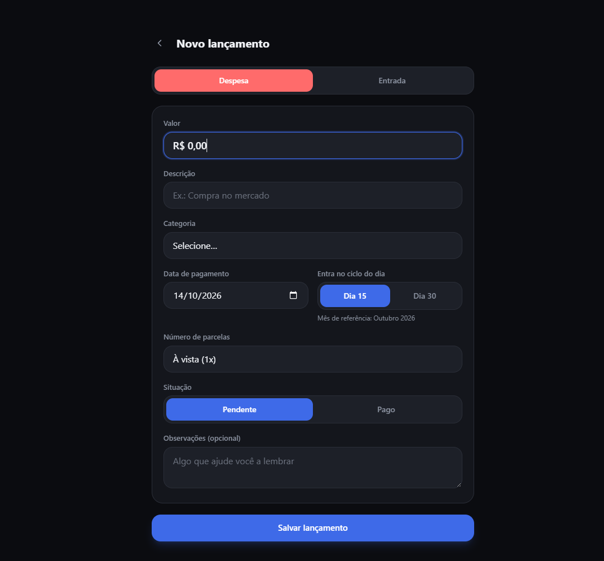

# Meu Financeiro

> Saiba exatamente quanto dinheiro você tem disponível em cada período do mês.

App de finanças pessoais (web e PWA, instalável no celular) que responde a uma pergunta: **quanto sobra no dia 15 e no dia 30?**

🔗 **Demo:** [meu-financeiro-delta-five.vercel.app](https://meu-financeiro-delta-five.vercel.app)



## O problema

Quem recebe quinzenalmente precisa saber quanto está livre em cada pagamento. Planilhas e apps genéricos não separam os dois ciclos, e o saldo do mês acaba misturando dinheiro que ainda não entrou com contas que vencem antes dele.

## A solução

O Meu Financeiro calcula o saldo disponível de cada ciclo (dia 15 e dia 30) separadamente, e eles nunca se misturam.

### Funcionalidades

- **Dois ciclos independentes:** saldo disponível, valor recebido, valor comprometido e o que já foi pago ou ainda falta pagar em cada ciclo
- **Lançamentos manuais**, sem integração bancária: despesas e entradas, com categoria, data de pagamento, ciclo, observações e situação (pendente ou pago)
- **Parcelamentos:** as parcelas caem no mês certo
- **Contas recorrentes** (aluguel, luz, internet): lançadas automaticamente todo mês
- **Salário flexível:** recebido em duas datas (dia 15 e 30) ou em uma só
- **Entradas "a receber":** ficam pendentes até serem marcadas como recebidas
- **Categorias personalizáveis:** podem ser editadas ou excluídas
- **Análises:** gráficos de gastos por categoria, entradas × saídas, evolução das despesas e do saldo, com filtros de mês atual, 3, 6 e 12 meses
- **Reserva de emergência** com projeção
- **Tema claro e escuro** e modo **"ocultar valores"**
- **Onboarding guiado** para configurar o primeiro mês em 3 passos

## Telas

| Configuração do primeiro mês | Análises |
| --- | --- |
|  |  |

| Novo lançamento |
| --- |
|  |

## Stack

| Camada | Tecnologias |
| --- | --- |
| Front-end | Next.js 15, TypeScript, Tailwind CSS |
| Back-end | Supabase (PostgreSQL, Auth, Row Level Security) |
| Gráficos | Recharts |
| Testes | Vitest |
| Deploy | Vercel |

## Destaques técnicos

- **Valores em centavos inteiros:** evita erros de arredondamento de ponto flutuante nos cálculos financeiros.
- **Isolamento de dados por usuário no banco:** cada usuário só acessa os próprios dados, garantido por **Row Level Security** no Postgres e validado por **31 testes de isolamento**.
- **39 testes automatizados** cobrindo a lógica financeira (saldos por ciclo, parcelas, recorrências).
- **Evolução sem perda de dados:** alterações no banco feitas sem apagar os dados de quem já usava o app.
- **Desenvolvido do zero a partir de um mockup**, com ajustes de UX para iPhone e instalação como PWA.

## Como rodar localmente

Pré-requisitos: Node.js 18+ e um projeto no [Supabase](https://supabase.com).

```bash
# clonar o repositório
git clone https://github.com/<seu-usuario>/<nome-do-repositorio>.git
cd <nome-do-repositorio>

# instalar dependências
npm install

# configurar variáveis de ambiente
# crie o arquivo .env.local com as chaves do seu projeto Supabase:
# NEXT_PUBLIC_SUPABASE_URL=...
# NEXT_PUBLIC_SUPABASE_ANON_KEY=...

# rodar em desenvolvimento
npm run dev
```

Para executar os testes:

```bash
npm test
```

## Status

No ar, com usuários reais testando.

## Autor

**Hugo Fernandes Costa**
Analista de Infraestrutura e Suporte de TI · Segurança e Cloud

[LinkedIn](https://www.linkedin.com/in/hugo-fernandes-costa-b643aa242/)
